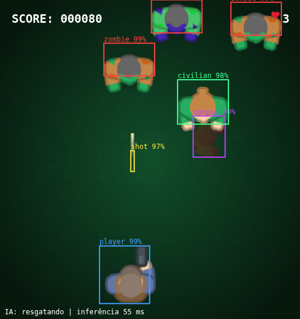

# Zombie Attack IA

Um jogo de zumbis em Phaser 3 que **uma IA joga olhando só para a tela**. O detector (YOLOv5n) foi treinado nos frames do próprio jogo e roda no navegador com TensorFlow.js; uma política simples transforma o que ele vê em teclas.

O desafio extra: no meio dos zumbis corre uma **sobrevivente que precisa ser salva**. Ela é humana, então a IA tem de reconhecer que não é zumbi, **não atirar nela** e ir ao encontro dela quando for seguro.



O jogo base é o [Zombie Attack](https://github.com/flpfar/zombie-attack) de Felipe Rosa (MIT). Este projeto troca a arte por arte livre, remove o placar remoto e acrescenta o jogador de IA e as ferramentas para gerar o dataset, treinar e exportar o modelo.

## Como a IA joga

```
canvas do jogo --frame--> Web Worker (YOLOv5n em TFJS) --caixas--> política (agent.js) --teclas--> jogo
        ^                                                                                       |
        +---------------------------------------- ~100 ms ---------------------------------------+
```

1. A cada ~100 ms o frame do canvas vai para um Web Worker, vira um tensor 640x640 e passa pelo YOLOv5n (o NMS já está dentro do modelo exportado).
2. O detector devolve caixas de 5 classes: `zombie`, `player`, `shot`, `civilian` (a sobrevivente) e `corpse` (zumbi ou sobrevivente morrendo, que a IA ignora).
3. `src/ml/agent.js` calcula, para cada zumbi descendo, a faixa de posições em que o jogador seria atingido. O jogador só anda dentro do trecho livre onde está (atravessar uma faixa é levar o zumbi) e, dentro dele, para a posição que alinha o tiro com o zumbi mais baixo. A política compensa o atraso do frame (~150 ms) estimando onde o jogador está *agora* a partir das teclas que ela mesma apertou.
4. As teclas voltam ao jogo como eventos de teclado, como se fossem de uma pessoa.

### A sobrevivente

A sobrevivente desce a tela entre os zumbis. As regras do jogo: **+50** se o jogador encosta nela, **-100** se leva um tiro (a pior penalidade do jogo) e **-40** se um zumbi a pega ou ela passa do fim da tela. O que a IA faz:

- **Segura o tiro.** Se a sobrevivente está na linha do tiro e mais perto que o zumbi-alvo, a IA não atira, porque o tiro a acertaria primeiro. Se ela está *acima* do zumbi, atirar é seguro: o zumbi leva o tiro antes.
- **Vai resgatar.** Quando ela chega a ~300 px acima, a IA vai para a pista dela e espera que ela encoste. Só vai se o caminho estiver livre de zumbis; senão, continua cuidando dos zumbis.
- **A fuga continua tendo prioridade.** Resgatar nunca vale uma vida.

O ponto central é visual: ela é detectada como `civilian`, não como `zombie`. Vistos de cima os dois têm silhueta parecida, e o detector os separa na validação com precisão de 0,97 (civilian) e 0,97 (zombie). Não investiguei em quais pistas visuais ele se apoia.

Ligue com `?ia=1` na URL. A camada transparente por cima do jogo mostra as caixas, a confiança e o que a IA decidiu.

## Rodar o jogo

Requer Node 22 ou superior.

```bash
npm ci --ignore-scripts
npm start -- --port 8097        # http://localhost:8097  (jogo normal, setas + espaço)
                                # http://localhost:8097/?ia=1  (jogador de IA)
npm test                        # 30 testes (política da IA e placar)
npm run build                   # versão de produção em dist/
```

O modo de IA precisa de **WebGL com GPU**. Com renderização por software (por exemplo o Chromium sem interface, que usa SwiftShader) a inferência passa de 800 ms e a IA não consegue jogar. Em navegador normal a inferência leva cerca de 60 ms (RTX 3050 Laptop).

## Resultados

**Detector** (756 frames de validação, 4.586 objetos):

| Classe | Precisão | Recall | mAP50 | mAP50-95 |
|---|---|---|---|---|
| zombie | 0,974 | 0,984 | 0,992 | 0,988 |
| player | 0,999 | 1,000 | 0,995 | 0,995 |
| shot | 1,000 | 0,988 | 0,988 | 0,955 |
| corpse | 0,995 | 0,949 | 0,991 | 0,973 |
| civilian | 0,971 | 1,000 | 0,995 | 0,995 |
| **todas** | 0,988 | 0,984 | 0,992 | 0,981 |

Treino: 30 épocas (~50 minutos), fine-tuning do YOLOv5n a partir dos pesos do COCO, com 5.006 frames (4.250 de treino e 756 de validação).

**Jogando** (3 partidas de 75 s no navegador com GPU, medidas por `tools/avaliar_ia.mjs`):

| Zumbis | | Sobrevivente | |
|---|---|---|---|
| Abates | 125 | Resgatadas | 13 |
| Tiros perdidos | 46 | Mortas por tiro da IA | 1 |
| Passaram do fim da tela | 80 | Perdidas (pega por zumbi ou fora da tela) | 12 |
| Vidas perdidas | 0 | | |

Precisão de tiro: 73%. A IA sobreviveu aos 75 s nas 3 partidas. Em 26 desfechos, **13 sobreviventes foram salvas (50%)**, 1 morreu por tiro e 12 se perderam. Variou muito entre partidas: 6, 5 e 2 resgates, e a terceira partida concentrou 7 das 12 perdas.

A pontuação do jogo continua baixa mesmo com a IA viva, porque cada tiro perdido custa 20 pontos, cada zumbi que passa custa 40 e a sobrevivente perdida custa 40.

Como a política evoluiu (mesma medição, antes da sobrevivente): a primeira versão perdia as 3 vidas em 22 a 76 s (65 abates, 9 vidas perdidas em 3 partidas). Os erros eram dois: não saber que o corpo de colisão do Phaser é centrado no sprite e menor que o desenho, e escolher um destino sem checar se o caminho até ele atravessava outro zumbi.

## Como o detector foi feito

Não houve rotulagem manual: o jogo sabe onde está cada objeto.

```bash
# 1. dataset: um bot joga e, a cada 4 quadros, grava o frame e as caixas lidas do estado do Phaser (formato YOLO)
node tools/coletar_dataset.mjs --amostras 5000          # com o jogo servindo em :8097

# 2. treino (YOLOv5 v7.0 + PyTorch com CUDA)
git clone --depth 1 --branch v7.0 https://github.com/ultralytics/yolov5.git ml/yolov5
python3 -m venv ml/.venv-yolo   # instale torch com CUDA e os requisitos do YOLOv5 (sem a linha do protobuf)
ml/.venv-yolo/bin/python tools/treinar_yolo.py --epochs 30 --batch 16

# 3. exportação para TensorFlow.js, com NMS dentro do modelo
python3 -m venv ml/.venv-tfjs && ml/.venv-tfjs/bin/pip install torch torchvision --index-url https://download.pytorch.org/whl/cpu
ml/.venv-tfjs/bin/pip install -r ml/requirements-tfjs.txt   # instale o protobuf por último (veja o arquivo)
PATH="$PWD/ml/.venv-tfjs/bin:$PATH" PYTHONPATH=tools ml/.venv-tfjs/bin/python tools/exportar_tfjs.py
cp ml/runs/zombie/weights/best_web_model/* src/ml/modelo/

# 4. medir a IA jogando
node tools/avaliar_ia.mjs --partidas 3 --segundos 75
```

Detalhes que valem saber:

- **Para a sobrevivente aparecer em quantidade**, o bot de coleta tenta resgatá-la na metade das vezes. Sem isso ela morria cedo demais e a classe ficava rara.
- **Frame e rótulo vêm do mesmo instante de render** (gancho no evento `postrender` do Phaser), e a caixa de cada sprite é a justa, calculada pelo canal alfa da imagem.
- **A imagem é esticada para 640x640, sem letterbox**, no treino e na inferência. Se um lado usasse letterbox e o outro não, as caixas sairiam deslocadas.
- **A validação são blocos contíguos do fim da coleta** (15%), não quadros sorteados: quadros vizinhos são quase iguais e vazariam para o treino.
- `tools/yolo_compat.py` ajusta o YOLOv5 v7.0 ao PyTorch 2.6 e ao NumPy 2. Em vez de carregar o checkpoint com `weights_only=False` (que executa código do arquivo), libera só as classes do YOLOv5, do `torch.nn` e do NumPy que ele precisa.
- `tools/gerar_arte.py` monta as spritesheets a partir do pacote do Kenney (rotaciona as poses e cria os quadros de caminhada e de morte).

## Estrutura

```
src/game/            o jogo (Phaser 3)
src/ml/              a IA: worker.js (detector), agent.js (política), main.js (liga tudo), overlay.js, modelo/ (TFJS)
tools/               dataset, treino, exportação, avaliação e geração de arte
__tests__/           testes (Jest)
ml/                  dataset, runs e ambientes Python (fora do git)
```

## Limitações

- O detector só conhece **este jogo com esta arte**. Trocar os sprites exige recoletar e retreinar.
- As medições da IA são poucas partidas (3 de 75 s) e a variação entre partidas é grande. A política foi ajustada olhando esse mesmo tipo de medição, então os números mostram que ela funciona, não uma estimativa de desempenho em jogos novos.
- A validação do detector usa frames do mesmo tipo de partida do treino (jogo gerado por um bot). Não houve conjunto de teste separado.
- A política assume velocidade fixa para jogador, zumbis e sobrevivente, lida do código do jogo.
- **A IA salva só metade das sobreviventes.** Perde as que estão cercadas de zumbis (o caminho até elas não é seguro) e as que um zumbi alcança antes. Há espaço para melhorar a política (por exemplo, atirar no zumbi que persegue a sobrevivente antes de ir buscá-la).

## Créditos e licenças

- **Jogo original:** [Zombie Attack](https://github.com/flpfar/zombie-attack), Felipe Rosa, MIT. Este repositório mantém a licença e o aviso de copyright dele.
- **Código novo** (IA, ferramentas, testes): MIT, Laion Jordi.
- **Arte do jogo** (jogador, zumbis e sobrevivente): [Top-down Shooter](https://kenney.nl/assets/top-down-shooter), Kenney (kenney.nl), CC0. Fundo, vida, tiro, logo e fonte são gerados por `tools/gerar_arte.py`; a fonte bitmap vem do DejaVu Sans Mono Bold (licença livre).
- **Botões:** [UI Button](https://opengameart.org/content/ui-button), StumpyStrust, CC0.
- **Detector:** YOLOv5 ([Ultralytics](https://github.com/ultralytics/yolov5), AGPL-3.0) usado como ferramenta de treino e exportação. Os pesos em `src/ml/modelo/` são derivados dele; se você redistribuir o modelo, confira as condições da AGPL-3.0. O YOLOv5 em si não é distribuído neste repositório.
